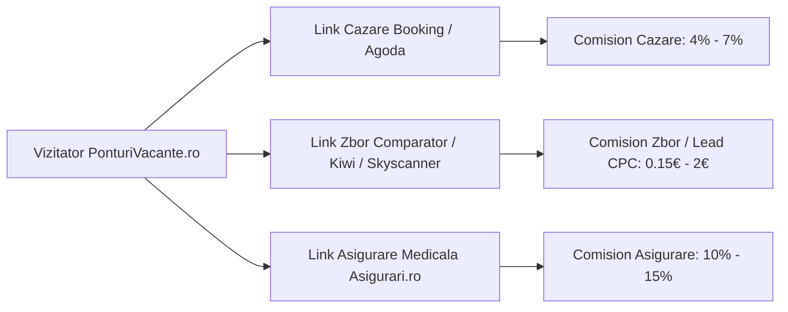

# 🚀 Plan Strategic de Promovare & Creștere — PonturiVacante.ro

Acest plan este conceput specific pentru modelul **PonturiVacante.ro**: vacanțe pe cont propriu (DIY), prețuri defalcate transparent (zbor + cazare verificată) și plecări din toate marile orașe din România.

---

## 🧭 Poziționare & Propunere Unică de Valoare (UVP)

> **Mesajul cheie:** *„Călătorești inteligent, fără comisioane de agenție. Noi găsim combinațiile de zbor și hotel la preț minim — tu rezervi direct la sursă.”*

### Avantajele competitive ale site-ului:
1. **Acoperire regională unică:** Oferte dedicate din 8 aeroporturi (București, Cluj, Timișoara, Iași, Sibiu, Craiova, Suceava, Constanța).
2. **Defalcare realistă la centimă:** Zbor dus-întors cu dimensiuni bagaj incluse + cazare 3★ verificată + total clar `/pers`.
3. **Fără costuri ascunse:** Link direct la companiile aeriene (Ryanair, Wizz) și pe comparatoare (Booking, Agoda, Skyscanner).

---

## 📱 Pilonul 1: Canale de Distribuție Rapidă & Notificare Zilnică (Retenție Maximă)

În turismul de chilipir (low-cost), cele mai bune prețuri se vând în câteva ore. Utilizatorii care primesc primul pont cumpără cel mai repede.

### 1. Canal Oficial WhatsApp & Telegram
- **De ce funcționează:** Rata de deschidere pe WhatsApp este de peste **85%** (față de 15-20% pe email).
- **Formatul mesajului (zilnic, max 2 postări):**
  - Ora ideală: **09:30** (cafeaua de dimineață) sau **18:30** (drumul spre casă).
  - *Exemplu:*
    > ✈️ **Chilipir din Timișoara:** Milano & Lacul Como — 3 nopți la hotel 3★ + Zbor direct = **79 € / pers**!  
    > 📅 12 – 15 Ianuarie 2027 (Wizz Air + Booking)  
    > 🔗 Vezi detaliile și linkurile directe: https://ponturivacante.ro/oferta/city-break-milano-din-timisoara-79-euro/

### 2. Notificări Web Push (OneSignal - Gratuit)
- Un pop-up discret pe site: *„Vrei să primești alertă când apare un city break sub 100 € din orașul tău?”*
- Trimitere de alerte doar pentru ofertele sub 100 € sau scăderi mari de preț.

### 3. Newsletter Săptămânal („Vineri la Prânz”)
- Trimitere în fiecare vineri la ora 12:00: *„Top 5 city breaks sub 100 € pentru weekendul viitor”*.
- Segmentează utilizatorii după orașul de plecare (clujenii primesc oferte din CLJ, moldovenii din IAS etc.).

---

## 🎥 Pilonul 2: Video Scurt Viral (TikTok, Instagram Reels, YouTube Shorts)

Nișa de vacanțe ieftine este una dintre cele mai virale categorii pe TikTok și Reels în România.

### Structura unui clip viral de 20-30 secunde:
1. **Hook (primele 3 secunde):**  
   *„Cum am găsit vacanță în Italia cu 79 € cu tot cu avion și cazare 3 nopți din Timișoara?”* (sau *„Nu mai plăti 400 € la agenție pentru un weekend la Roma!”*).
2. **Dovada pe ecran (secundele 4-15):**  
   Screen record cu site-ul ponturivacante.ro arătând cardul ofertei, zborul Wizz de 30 € și camera de hotel Booking de 49 €.
3. **Call-To-Action (secundele 16-25):**  
   *„Linkul direct către zbor și hotel e salvat pe site-ul PonturiVacante.ro. Salvează clipul ca să nu pierzi oferta!”*

### Tipuri de clipuri cu tracțiune garantată:
- **Seria „Top 3 orașe unde zbori sub 50 € luna asta din [Cluj / Iași / București]”**
- **Seria „Comparație: Agenție vs. DIY pe PonturiVacante.ro”**
- **Seria „Regula rucsacului gratuit 40x30x20: Cum împachetezi pentru 4 zile fără să plătești bagaj”**

---

## 👥 Pilonul 3: Comunități & Grupuri de Facebook (Trafic Gratuit Imediat)

Grupurile de Facebook sunt pline de oameni care întreabă activ: *„Unde putem merge un weekend ieftin din Timișoara / Cluj?”*.

### Strategie de postare non-spam:
1. **Grupuri mari de călătorii:**
   - *Vacanțe sub 200 Euro*, *Călătorii pe cont propriu*, *City Breaks România*, *Iubitori de Grecia / Italia*.
2. **Grupuri locale de oraș:**
   - Grupuri de comunitate: *„Locuitori în Cluj-Napoca”*, *„Iași Oficial”*, *„Timișoara Noastră”*, *„Constanța Evenimente”*.
3. **Format postare de succes:**
   - Nu pune doar un simplu link gol. Pune o poză superbă + defalcarea costurilor în text:
     > *„Pentru cei care căutați o escapadă ieftină de iarnă din Iași: am verificat un pachet complet pentru Milano (3 nopți cazare bună aproape de gară + zbor direct Ryanair) la 85 € de persoană. Tot calculul și linkurile directe sunt aici: [link]”*

---

## 🔍 Pilonul 4: SEO Local pe Aeroporturi & Conținut Evergreen

Site-ul are deja o arhitectură tehnică impecabilă (91 de pagini statice ultra-rapide pe Cloudflare). Pasul următor este captarea căutărilor organice din Google:

### 1. Pagini SEO Locale pe Aeroporturi
Oamenii caută în Google:
- `city break din timisoara ieftin`
- `vacante din cluj napoca`
- `zboruri ieftine iasi vacante`
- `city break din suceava`

Paginile `/plecari/timisoara/`, `/plecari/cluj-napoca/`, `/plecari/iasi/` etc. sunt deja create. Trebuie doar promovate și linkate intern pentru a începe să rankeze în primele rezultate.

### 2. Articole de Blog cu Intenție Comercială Mare:
- *Ghid complet: Cum zbori doar cu rucsacul gratuit la Wizz Air și Ryanair fără taxe extra.*
- *Cum să faci o vacanță în Dolomiți la schi pe cont propriu sub 300 €.*
- *Top 5 destinații călduroase de iarnă în Europa sub 150 €.*

---

## 💰 Pilonul 5: Monetizare & Scalare Parteneriate

Pe măsură ce traficul crește, site-ul generează venituri pasive din mai multe surse paralele:

1. **Booking.com & Agoda Partners:** Comisioane între 4% și 8% din valoarea fiecărei nopți rezervate.
2. **Platforme de zbor (Travelpayouts / Kiwi / Skyscanner):** Comision per bilet emis sau CPC per căutare.
3. **Asigurări de călătorie:** Redirecționarea activă către `asigurari.ro/asigurare/travel` aduce comision consistent la fiecare poliță încheiată pentru vacanțe la schi sau city break.
4. **Articole sponsorizate & bannere native:** Cabane din România, pensiuni sau branduri de echipamente/trollere care vor expunere către călători activi.

---

## 📅 Plan de Acțiune pe Săptămâni (Faza de Lansare)

| Săptămână | Acțiuni Cheie | Obiectiv |
| :--- | :--- | :--- |
| **Săptămâna 1** | • Creare canal WhatsApp & pagină Facebook/Instagram. • Adăugare buton WhatsApp în header și pe fiecare ofertă. • Primele 5 postări pe grupuri de călătorii cu ofertele locale (Timișoara, Iași, Cluj). | Primii 200 de urmăritori & abonați WhatsApp. |
| **Săptămâna 2** | • Primele 3 TikTok-uri / Reels filmate pe ecran cu ofertele sub 100 €. • Înscriere în platformele de afiliere (Travelpayouts / Booking / 2Performant). | Primele 1.000 de vizite zilnice din video scurt. |
| **Săptămâna 3** | • Activare notificări OneSignal Web Push. • Lansare newsletter săptămânal de vineri. • Distribuire oferte pe Reddit (r/Romania, r/cluj, r/timisoara). | Rata de recurență a utilizatorilor crește la >30%. |
| **Săptămâna 4** | • Analiză Google Analytics / Cloudflare: care orașe și categorii (Schi vs. City Break) au cel mai mare CTR. • Dublarea ofertelor pe categoriile cele mai căutate. | Primele comisioane din rezervări generate. |
